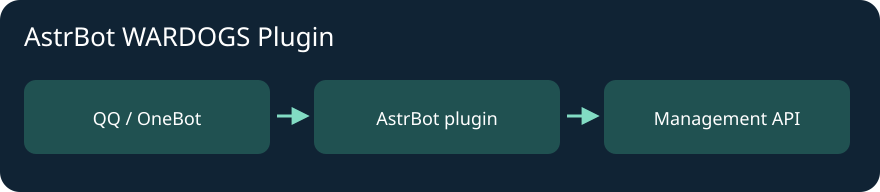

# AstrBot WARDOGS Plugin

[简体中文](README.zh-CN.md) · [Operations](docs/OPERATIONS.md) · [AI workflow](AGENTS.md) · [Minimal settings example](config.example.json)

An AstrBot plugin for WARDOGS server queries, kill history, evidence review and scoped moderation. This is the final snapshot of a retired community server, published as a read-only archive.

1. Use AstrBot 4.29.4 with Python 3.12. Install with the repository URL in AstrBot, or copy the sources to the plugin directory as `astrbot_plugin_wardogs` and install `requirements.txt` in AstrBot's Python environment.
2. Deploy the [companion backend](https://github.com/RhoninSeiei/wardogs-server-tools). In plugin settings, enter its reachable URL and the path to its query token.
3. For QQ Official, set `official_only`, enable public queries and add your exact platform instance, AppID and group OpenID to `official_query_scopes`. OneBot instead uses the platform instance, bot QQ and allowed group numbers.
4. Select text, image and fallback providers in AstrBot. Clearing a primary selection inherits the session provider. A blank fallback turns it off.
5. Mention the bot and try `服况` or `服id`. Use a substitute service to test moderation separately.

MIT licensed. Dependencies retain their respective licenses.
