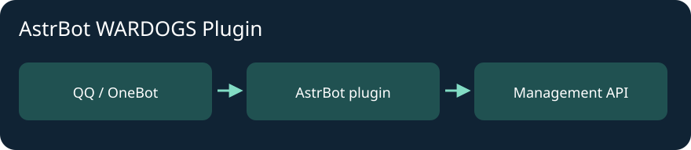

# AstrBot WARDOGS 插件

[English](README.md) · [运维手册](docs/OPERATIONS.md) · [AI 工作流](AGENTS.md) · [最小配置示例](config.example.json)

适用于 WARDOGS 自管服务器的 AstrBot 插件，支持服况、击杀回溯、举报及受权限约束的管理操作。原社区服务器已停运，本仓库是最终公开归档。

1. 使用 AstrBot 4.29.4 和 Python 3.12。通过仓库地址安装，或把源码放到插件目录并命名为 `astrbot_plugin_wardogs`，在 AstrBot 环境安装 `requirements.txt`。
2. 部署[后端管理服务](https://github.com/RhoninSeiei/wardogs-server-tools)，填写插件可访问的 URL 和查询令牌文件路径。
3. QQ 官方机器人需配置 `official_only`、公共查询开关，以及精确的平台实例、AppID 和群 OpenID。OneBot 则填写平台实例、机器人 QQ 和允许群号。
4. 在 AstrBot 面板选择文字、图片和回退模型。清空主模型继承会话模型，清空回退模型则关闭回退。
5. 在允许群内发送 `@机器人 服况` 或 `@机器人 服id` 验证。启用管理操作前，使用替代后端验证身份和确认流程。

本项目采用 MIT 许可证。第三方依赖各自适用原许可证。
